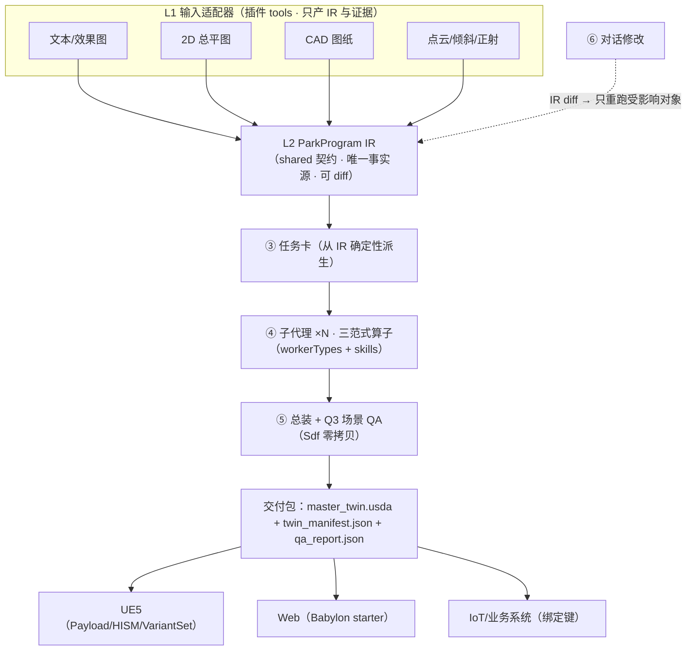

# 数字孪生园区：在 genex-desktop 中的规划与设计（v2）

> 日期：2026-10-21 ｜ 分支：`codex-ccswitch`（HEAD `d3ad8e0b`）
> v2 修订：对齐《数字孪生技术架构》ARCH-01 v3.0（园区三维数字孪生生成平台），并落实两条用户纠正——
> ① 输入数据（CAD/总平图/点云/倾斜）**多是平面/证据数据，无法直接还原三维，建模是主线**；
> ② harness 的审核标准要从"做游戏"扩到"做园区、城市、车间"，场景类要求一起变。

---

## 0. 结论先行

**落点不变，建模观和审核观重写：**

| 层 | 角色 | 本次放什么 |
|---|---|---|
| **插件（主落点）** | 宿主能力 | 插件 `twin-park`：输入适配器 + 几何算子（nativeJobs）+ IR 校验 + QA 门 + 导出器 |
| **项目脚手架** | 项目骨架 | `src/twin-template/` + `catalog/` 型谱库 + 交付包结构 |
| **Skill（知识层）** | 方法论 | `facts:` 按场景类（园区/城市/车间）过滤的孪生技能组 |
| **Harness 本体** | 智能体如何工作 | 机制不动；**审核内容**（judge rubrics / 降级梯纪律）随场景类更新 |
| **Workflow** | 不存在引擎 | 不造：director 计划 + 15 个 hook 时刻 + nativeJobs 固定配方 |

**建模观（纠正后）**：输入只产 **IR 与证据**，三维模型由**确定性算子参数化重建**——范式一 参数化楼体（~60%）、范式二 引用+PointInstancer（~25%）、范式三 资产补全（~15%）。大模型只输出受 Schema 约束的参数，**从不输出顶点**（P1）。所以"建模"是主线，但是算子建模，不是手工雕、也不是导入即所得。

**审核观（新增）**：Q0–Q5 六道质量门 + 降级梯（回馈 ≤2 → 规则基线 → LOD1 体块标 `degraded`，单对象失败不阻塞整园）；园区/城市/车间三类场景的 IR 深度、算子集、QA 侧重、绑定模型**分开要求**（§2.4）。

**与参考架构的协同**：数字孪生的规划主脑是 DeepSeek-V4 Pro（OpenAI 兼容接口）——即本工作室**已接入的 inLink 网关模型**；子代理小模型 Qwen3.6-35B-A3B 走 SGLang/vLLM——即 local-server 本地模型路线。L0 模型层与工作室现有引擎接入天然重合。

---

## 1. 三层现状（结论同 v1，证据从略）

- Harness = 智能体运行时（`src/harness-seed/`，可自修改、watchdog 回滚）；`PIPELINE_PHASES` 是硬编码 TS 数组，**无工作流引擎**。
- Skill 三套系统：harness skills（`facts:` 过滤）、plugin skills（manifest `skills[]`）、`.agents/skills`（工程技能）。
- Workflow 不存在：director 决策驱动 + `src/shared/plugin-hooks.ts` 15 个时刻（`run.prepare`/`worker.start`/`finish` 等 7 个可阻塞）+ blender 插件的 nativeJobs 固定配方。

---

## 2. 需求分解

### 2.1 典型建设内容（五层）

感知层（IoT/视频/传感器 → JetLinks）、数据层（GIS/BIM/CAD/点云）、平台层（CIM 底座/地理配准）、应用层（运营/安防/能源/停车/应急）、展示层（web 大屏/桌面/VR）。合规：CGCS2000、CIM 导则、等保 2.0、信创、数据不出域（条目以项目可研为准）。

### 2.2 数字孪生建模 ≠ 游戏建模

| 维度 | 游戏建模 | 数字孪生建模 |
|---|---|---|
| 对象 | 风格化资产 | **工程元素：建筑、设备、道路、路灯、管线** |
| 来源 | 手工雕刻 | **工程数据 + 参数化重建** |
| 精度 | "看着对"即可 | **尺寸/配准有误差预算**（Q4：与 CAD 轮廓 IoU、高度误差） |
| 组织 | 逐个资产 | **型谱 + 实例化**（1000 盏灯 = 1 引用 + 1000 prim） |
| 语义 | 视觉优先 | **数据优先**（编号/回路/权属/绑定键） |
| LOD | 整体统一 | **分级**：白模 LOD0/1 + 重点精模 LOD3/4 |

### 2.3 建模主线：输入 → IR → 参数化重建（对 v1 的纠正）

v1 说"导入优先、建模其次"是**错的**。参考架构 D11 写明：点云、倾斜、CAD、总平图都只做输入适配器，**只产 IR**；扫描网格粘连、没有语义，拆不出栋和楼层——作为证据进 IR，才能重建出分层的语义模型。

正确主线：

```
平面/证据数据（CAD 轮廓、总平图、点云、正射）
   → ParkProgram IR（J1 任务书 / J2 总图 / J3 对象，字段带来源+置信度+锁定）
   → 任务卡（从 IR 确定性派生：轮廓、层数、限高、临路边、seed）
   → 三范式几何算子重建（大模型只给参数，算子生成全部几何）
   → 单对象 .usdc（局部原点）→ 零拷贝总装 → Q3 场景 QA → 交付包
```

重建三范式（参考架构 L5）：

| 范式 | 占比 | 内容 | 算子 |
|---|---|---|---|
| 一 · 参数化楼体 | ~60% | 任意多边形底面挤出（矩形/L/U/回字/退台）；抽屉楼层 F01..N；立面按材质槽切 GeomSubset；米制 UV（primvars:st + 每格 st1 假室内视差）；楼板/走廊/隔墙/核心筒/女儿墙/机组；−2.0 m 防悬空裙边 | OpenUSD + Shapely + mapbox-earcut + NumPy |
| 一附 · 道路与场地 | — | 路网中心线 buffer-union 成路面；15 cm 路牙/标线/斑马线；景观 = 地块 − 楼 − 路（做差保证无缝）；地形/广场/水面 | Shapely + networkx |
| 二 · 引用+PointInstancer | ~25% | 树/灌木/路灯/座椅按散布规则写 protoIndices/positions/orientations；摄像头/道闸用 References + 绑定键；万级实例一个 prim，UE 端合 HISM | OpenUSD + SciPy |
| 三 · 资产补全 | ~15% | 先查型谱库/模板，最后才图生 3D；底座归零对齐包围盒 → LOD0/1/2 减面 → 重展 UV → LOD 变体；光栅化用 PyTorch3D/Embree（**不用非商用 nvdiffrast**） | trimesh/manifold3d/pyfqmr/meshoptimizer/xatlas |
| T2 · DSL 沙箱 | 5–15% | 地标/异形：小模型写受限 DSL 调同一套算子；进程隔离 + AST 白名单 + 2 s 超时；失败退回 T3 或规则基线 | RestrictedPython |

### 2.4 场景类：园区 / 城市 / 车间（用户要求"一块变"）

同一套 IR + 算子底座，三类场景的要求分开：

| 维度 | 园区（park） | 城市（city） | 车间（workshop） |
|---|---|---|---|
| 规模 | 500+ 对象、万级实例 | 递归扇出：城市 → 片区 → 园区 → 对象 | 数十~数百设备，小规模深语义 |
| 生成重点 | 总图布局（退线/容积率/防火间距 GB 50016 硬约束）+ 楼体 | 片区合并、LOD 层级、HLOD | 设备级精度、产线/工位/节拍 |
| 数据源 | 文本/总平图/CAD | 城市级 GIS + 倾斜 + 点云 | CAD/BIM + PLC/MES/SCADA + 传感器 |
| 绑定深度 | 绑定键（设备/视频/门禁） | 汇总指标为主 | **实时属性 + 反控 + 仿真** |
| 渲染 | UE5 Payload 懒加载（3 s 就位）/ Web | 3D Tiles 流式（Cesium/deck.gl）/ HLOD | 高保真交互、漫游巡检 |
| QA 侧重 | Q1 布局自洽 + Q4 保真度 | Q3 体量/组合 + 性能预算 | Q4 尺寸精度 + 绑定正确性 + 时延 |
| facts / 技能 / rubric | `twin-park` | `twin-city` | `twin-workshop` |

落到工作室：`detect` 规则按场景类给 fact；技能组分公共内核（IR 纪律/算子/USD 结构）+ 场景类附录；judge rubric 按场景类分册；孪生 run 的 brief 规则按场景类切换。

### 2.5 为什么这个工作室合适

团队已有 GIS 栈（GeoServer/3D Tiles/terrain/GDAL）、IoT（JetLinks）、inLink 模型网关（qwen3.8-max + deepseek-v4-pro，正是参考架构的规划主脑选型）、local-server 本地模型（子代理小模型路线）。缺的是项目种类、IR 契约和算子集——都是插件体系的扩展点。

---

## 3. 参考架构映射：数字孪生 L0–L7 → genex-desktop

| 数字孪生层 | 内容 | genex 落点 |
|---|---|---|
| L0 模型与基础设施 | DeepSeek-V4 Pro 主脑 / Qwen3.6-35B-A3B 子代理 / Qwen3-VL；Ray、/dev/shm、SeaweedFS | **inLink 引擎**（deepseek-v4-pro/qwen3.8-max）+ **local-server**；Ray ≈ nativeJobs/workerTypes；对象存储 ≈ 项目工作区 |
| L1 多源输入适配器 | 文本/效果图/总平图/CAD/点云/倾斜/正射/图片集 → **只产 IR** | 插件 `tools`（每类输入一个适配器工具）+ skills（判读规则） |
| L2 ParkProgram IR | 唯一事实源；Field[T] 外壳；来源/置信度/锁定；版本+diff | **shared 契约** `src/shared/twin-ir.ts` + 项目内 IR 文件（随 seed 快照版本化） |
| L3 规划编译 ①②③⑥ | 意图理解/总图求解（OR-Tools）/任务卡派生/对话修改 | 意图+风格=模型推理（inLink）；求解=确定性 nativeJob；派生=确定性 nativeJob；⑥=director 计划 |
| L4 Harness 并行子代理 | 一对象一图层；LangGraph 扇出；T1/T2/T3；降级梯 | **director run + workerTypes**（twin_modeler 等）；扇出=director 的 worker_start；T1 约束解码=引擎侧 Schema |
| L5 几何算子三范式 | 参数化楼体/引用实例/资产补全 + T2 DSL 沙箱 + Q2 盒内 QA | **nativeJobs**（固定配方，算子版本锁定）+ 插件工具 |
| L6 总装与场景 QA | Sdf.ChangeBlock 零拷贝；材质库；Q3 阻断；manifest/qa_report | nativeJob 总装 + `run.prepare`/`finish` hook 挂 Q1/Q3 门禁 |
| L7 交付与应用 | UE5 Stage/批处理/HISM/MRQ；Web 预览；IoT 绑定键；增量重导入 | 现有 unreal 插件扩展 + twin-template（Babylon）+ `export-glb`/发布 |

**采纳的设计原则（P1–P6）**：

1. **P1 参数而非顶点**——大模型只出受 Schema 约束的参数；顶点/UV/世界坐标全部由确定性算子生成，可校验可复现。
2. **P2 唯一事实源**——一切输入先归一成 ParkProgram IR；字段带来源、置信度和锁定；修改就是一次 diff。
3. **P3 写隔离**——一对象一图层，局部原点 (0,0,0) 建模；世界坐标只在总装时写；Sdf 层零拷贝组装（OpenUSD 是多读者单写者，并发写同一 Stage 会崩）。
4. **P4 就地降级**——校验/QA 失败只回馈本对象；降级梯兜到 LOD1 体块，整园总能交付。
5. **P5 确定可复现**——任务卡 + 风格版本 + 模型 + 算子版本 + seed 决定结果；大模型调用可录制回放，命中缓存直接复用。
6. **P6 引擎解耦**——USD 包 + manifest 同时服务 UE5、浏览器和业务系统；引擎逻辑只放各自导出器。

---

## 4. 目标架构



---

## 5. 分层设计详案

### 5.1 插件 `twin-park`（manifest API 3）

| 面 | 内容 |
|---|---|
| `detect` | `**/*.usd*`、`**/park.json` → fact `twin-park`/`twin-city`/`twin-workshop`（场景类由 IR 的 `scene_class` 字段或模板决定） |
| `engine` | `babylon`（web 变体）；Unreal 复用现有 engine 链接 |
| `scaffolds` | `park`（game:true）、`park-app`（应用模板）、`workshop`（车间） |
| `tools` | 输入适配器×8（text/plan-image/cad/pointcloud/oblique/ortho/photo）、`ir-check`（Q0/Q1）、算子系列（`gen-building`/`gen-road`/`scatter`/`asset-complete`）、`assemble`（Q3）、`export-glb`、`georeference`、`iot-bind`、`usd-info` |
| `nativeRuntimes` | `usd`（pip usd-core，sha256，三平台含信创 aarch64）、`dwg-tools`（**ODA File Converter，独立进程、不打包分发**）、`gdal`、`pdal` |
| `nativeJobs` | `dwg-to-dxf`、`solve-master-plan`（OR-Tools）、`gen-building`、`gen-road`、`scatter`、`asset-complete`、`assemble`、`usd-validate`、`usd-to-glb`、`qa-scene` |
| `workerTypes` | `twin_modeler`（楼/地标）、`twin_site`（道路场地）、`twin_scatter`（配景）、`twin_asset`（补全） |
| `skills` | file skills（见 5.6） |
| `hooks` | `run.prepare` 挂 Q0/Q1 门禁（**可阻塞**）；`checkpoint.before` 存 IR 版本；`worker.start` 查 usd runtime 就绪；`finish` 挂 Q3 汇总 |
| `locks` | `usd`（app 级，导出/总装串行，personFirst 让人优先） |
| `settings` | GeoServer URL、CGCS2000 参数、JetLinks 网关、场景类、导出目标 |

### 5.2 项目脚手架 `src/twin-template/` 与交付包

```
src/twin-template/
├── index.html / src/（main.js / park.js / studio.js / iot.js）
├── catalog/                    # 型谱库：灯杆/道路断面/建筑模板（工程规格，非美术资产）
├── park.json                   # 场景清单：scene_class / georef / bindings / renderTargets
└── docs/CONTRACT.md
```

交付包结构（对齐参考架构图 5，P6 引擎解耦）：

```
<park_id>/
├── master_twin.usda          # 只放组合弧和世界坐标
├── looks/twin_materials.usda # 语义材质槽 MI_Twin_*
├── buildings/B_0001…N.usdc   # 每栋一个 payload（局部原点建模）
├── site/*.usdc               # 地形/路网/景观
├── instancers/*.usdc         # 乔木/灌木/路灯/座椅，每类一个 PointInstancer
├── assets/protos/*.usdc      # 实例原型：树种/灯型/设备
├── layers/env · cameras.usda # 昼夜变体 / 相机轨
├── twin_manifest.json        # 每栋 sha256、轮廓、楼层表、绑定键、材质→UE 路径
└── qa_report.json            # 每对象 QA 结果
```

单栋层级（L 型研发楼 8 层范例）：`BaseAndSkirt/Plinth`（−2.0 m 防悬空）→ `Floors/F01..F08`（floorIndex/floorElevation/floorHeight/drawerAxis/drawerDistance，**抽拉楼层**）→ `Facade`（材质槽 GeomSubset）→ `Interior`（楼板/走廊/隔墙/核心筒）→ `Terrace`（退台）→ `Roof`（1.1 m 女儿墙/机组/楼梯间）→ `Looks`。网格约定：faceVarying 法线、写 extent、`subdivisionScheme=none`、米制 `primvars:st` + 每格 `st1`、`twin:cellSeed` 去重复感。

### 5.3 ParkProgram IR（shared 契约，P2）

`src/shared/twin-ir.ts`（as-const 词表 + 类型，仓库纪律）：

- **总表**：`brief`(J1: site/land_use/zones/indicators/key_elements/style/assumptions/conflicts/questions) · `master_plan`(J2: 红线/退线/地块/道路中心线与断面/楼位轮廓/分区/景观地块) · `objects[]`(J3: 参数/产物路径/状态 ok/degraded) · `style_guide`(带版本) · `environment`(地理位置/日照/时段变体/相机轨)
- **Field[T] 外壳**：`{value, source, confidence, locked, tolerance?, range?, evidence?, note?}`；**只有 source=user 能锁定**；12 种来源（user 0.95 / text_inferred 0.8 / derived 0.7 / archetype_default 0.6 + solver/llm/plan_image/cad/pointcloud/oblique/photo/manual）
- **多源融合优先级**：测量 > 图纸 > 图片推断 > 求解器 > 原型默认；低置信/冲突 → 问题单 → 校核台
- **自洽校验（Q1）**：占比和=1、栋数对得上、有冲突必有待问、层高之和≈测量高度、建筑互不重叠、在红线内、道路不穿楼
- **坐标约定**：场地局部 ENU（+Y 朝北、米、Z 向上），与 EPSG 互转（pyproj）
- **版本与 ID**：每次修改存一版可 diff；对象 ID 跨版本不变（分区+角色+空间匹配）；diff 只重跑受影响对象；按 sha256 增量重导入

### 5.4 Harness 审核（对 v1 的补充——用户第 2 点）

游戏评审看"好玩/好看"，孪生评审看"对不对/全不全/跑不跑得动"：

**Q0–Q5 质量门 → genex 落点**：

| 门 | 检查 | 不过时 | genex 落点 |
|---|---|---|---|
| Q0 输入 | 格式/坐标系/点密度/CAD 图层覆盖 | 提示用户 | 输入适配器工具前置检查 |
| Q1 IR | Schema 合法、多边形有效、布局自洽（见 5.3） | 问题单/修复 | `run.prepare` **阻塞** hook + `ir-check` 工具 |
| Q2 单图层（盒内 <5 ms） | 包围盒对 IR、Z_min ≤ 0、法线/UV、材质槽全绑定、kind/层级、面数预算 | 只重跑该对象 | 算子自带 QA（nativeJob 内断言） |
| Q3 场景 | 组合错误必须为 0、变体切换生效、实例计数、文件体量、兼容设置 | **阻断交付** | `assemble` job + `finish` hook |
| Q4 保真度（有测量输入时） | 与 CAD 轮廓 IoU、高度误差、点到面距离分布 | 问题单 | judge rubric（孪生分册） |
| Q5 视觉（可选） | 渲染与照片风格比对 | 提示 | judge rubric + 视觉模型 |

**降级梯（P4，harness 侧纪律）**：生成 → 校验失败回馈 ≤2 → 算子 → 盒内 QA 重试 ≤2 → 规则基线（不调大模型，按原型默认值）→ LOD1 体块标 `degraded`，照常参与总装；degraded 对象可后台单独重跑升级，**单对象失败不阻塞整园**。

**对象种类注册表（6 件套/类）**：提示模板 · Schema · 算子 · QA 规则 · 降级梯 · 规则基线。初始类目：Building / Landmark / Road / Landscape / Vegetation-Lamp / Env；车间场景类增设 Equipment / ProductionLine。

**复现与缓存（P5）**：缓存键 = hash(任务卡 + 风格版本 + 模型 + 算子版本 + seed)；大模型调用录制/回放。genex 侧：任务卡与 seed 随 IR 版本入库，命中缓存的 .usdc 直接复用。

### 5.5 双渲染（P6 引擎解耦）

USD 包是中立交付物，引擎逻辑只在导出器：Babylon starter 消费 GLB 导出（web 交付/大屏）；UE5 走 USD Stage 活连接（Payload 按栋懒加载 3 s 就位、PointInstancer→HISM、VariantSet 昼夜/LOD 保持可切、MI_Twin_* 母材质、crate 版本按 UE 插件锁定）或无人值守批处理（Cmd 脚本 → .umap / MRQ 4K）。参考架构 web 端用 three.js；本设计按用户要求走 **Babylon.js**，同一导出器模式，不影响中立性。

### 5.6 Skills（harness 内容层，按场景类过滤）

| 技能 | 内容 |
|---|---|
| `twin-ir` | IR 纪律：Field 外壳、来源优先级、锁定规则、ID 稳定、diff 重跑 |
| `twin-elements` | 元素词表与型谱：建筑/楼层/房间、道路中心线+横断面、灯杆实例化 |
| `twin-operators` | 三范式算子调用纪律：参数而非顶点、局部原点、网格约定 |
| `twin-input-adapters` | 八类输入判读规则（CAD 按图层、总平图 SAM+OCR、点云证据用法） |
| `gis-alignment` | CGCS2000→ENU、GeoServer 挂载、正射配准 |
| `park-standards` | CIM/等保/信创/防火间距（GB 50016）转化检查项 |
| `iot-binding` | 绑定键、楼层抽屉参数、反控安全边界 |
| 场景类附录 | park / city / workshop 的 IR 深度、算子集、QA 侧重差异（§2.4） |

### 5.7 为什么仍不造 workflow 引擎

参考架构用 LangGraph 状态图做外层编排（Send 动态扇出、interrupt 人工确认、checkpointer 版本库）——这正是 genex director run 的同类物（worker_start 扇出、Plan 模式人工确认、seed 快照版本化）。确定性派生与算子放 nativeJobs；门禁放可阻塞 hooks。造声明式 DAG 只会把智能体降级为调度器。

---

## 6. 输入支持（L1 适配器：只产 IR，不直接出几何）

| 输入 | 适配器 | 产出 | 备注 |
|---|---|---|---|
| 文本需求 | 模型推理 + 规则兜底 | J1 + 风格线索 | 无大模型时纯规则解析 |
| 效果图/鸟瞰图 | Qwen3-VL + MoGe 单目度量深度 | J1 + 体量 | 风格线索 |
| 2D 总平图 | SAM 2 + Florence-2 OCR + 视觉核对 | **直达 J2** | 跳过总图求解 |
| CAD 图纸 | ezdxf 按图层解析（红线/中心线/轮廓）；DWG 先经 **ODA File Converter**（独立进程） | J2 + 对象证据 | LibreDWG 因 GPL **不进交付链** |
| 激光点云 | PDAL/laspy/Open3D 地面滤除 → 轮廓(Polygon,H,Yaw) | J2 + 对象证据 | 语义分割自训小模型 |
| 倾斜摄影 | OSGB/3D Tiles（py3dtiles）读入 | **只当证据** | 粘连无语义，不当交付网格 |
| 正射影像 | GDAL/rasterio | 场地边界/道路/绿地 | 配准到场地 ENU |
| 现场图片集 | Grounding DINO/RT-DETR/SigLIP 2；够多走 COLMAP SfM | 对象证据 | 或转点云路径 |

---

## 7. IoT 实时绑定

`twin_manifest.json` 带设备绑定键（`twin:bindingKey`）+ 楼层抽屉参数；插件 `network` 能力对接 JetLinks（内网）；订阅设备属性驱动节点 transform/material；反控走确认卡，进程仍过 ProcessSandbox；断线由 `health`/`crash` hook 记 note 不阻塞。车间场景类额外支持产线节拍/工位状态/PLC 读写（反控+仿真）。

---

## 8. 许可合规（参考架构表 1/表 2，商用前法务复核）

| 组件 | 许可 | 判定 | 用途 |
|---|---|---|---|
| OpenUSD（usd-core） | TOST-1.0（Apache-2.0 派生） | ✓ | 全部 USD 读写/总装/QA |
| ODA File Converter | 专有免费 | ! 有条件 | DWG→DXF，**独立进程调用、不打包分发** |
| Shapely | BSD-3（GEOS LGPL-2.1） | ! 有条件 | 多边形/路网/做差（动态链接可商用） |
| ezdxf / GDAL / PROJ / pyproj | MIT | ✓ | DXF 解析 / 正射 / 坐标转换 |
| IfcOpenShell | LGPL-3.0 | ! 有条件 | IFC 读写（可选，动态链接可替换） |
| Pointcept | 代码 MIT，公开权重非商用训练 | ! 有条件 | 点云语义分割（自有数据重训） |
| TRELLIS | MIT（依赖 nvdiffrast 非商用） | ! 有条件 | 图生 3D（换 PyTorch3D/Embree 后端） |
| FLUX.2 [klein] 4B / Qwen-Image-Edit | Apache-2.0 | ✓ | 去遮挡修图/贴图（9B 版与 FLUX.1 dev 系禁用） |
| Unreal Engine 5 | 商业 EULA | © | 交付引擎（>$1M 营收 $1,850/席/年） |
| Fab/Megascans | Epic 条款 | © | 仅限 UE 内，不随 USD 包外发 |

**避用清单（不进交付链）**：Ultralytics YOLO（AGPL）→RT-DETR；MinIO（AGPL）→SeaweedFS；CGAL（GPL）→Shapely；MeshLab（GPL）→trimesh/Open3D；**LibreDWG（GPL）→DXF 流程/ODA**；OpenMVS（AGPL）→COLMAP；nvdiffrast 系（NVIDIA 非商用）→PyTorch3D/Embree；Depth Anything V2 Base/Large（CC-BY-NC）→MoGe。

> v1 风险表里"先 LibreDWG 打通流程"的建议作废——按参考架构表 2，LibreDWG 的 GPL 会进交付链，**一律改用 ODA File Converter 独立进程**（这也修正了 DWG 授权风险：ODA 专有免费软件，不打包分发即可）。

---

## 9. 分期实施计划

| 阶段 | 目标 | 交付物 | 验收 |
|---|---|---|---|
| **P0 契约与骨架** | 项目种类 + IR 立起来 | `twin-park` 插件最小集、`src/twin-template/`、**`src/shared/twin-ir.ts` + `twin-elements.ts`（test-first）**、`starterOfKind`/`ProjectShape` 扩展、feature-map 行 | 新建园区项目→Babylon 空场景可 Play；IR Schema 校验测试过 |
| **P1 输入与算子** | 平面数据重建三维 | usd-core/gdal/pdal nativeRuntime（ODA 独立进程）、CAD+正射+文本适配器、三范式算子 jobs、Q0–Q2 门禁、`twin-ir`/`twin-operators`/`twin-elements` 技能 | 一份 CAD 总平图 → J2 → 楼体 .usdc（楼层语义+裙边+材质槽）→ GLB → Babylon 可见；Q2 盒内 QA <5 ms |
| **P2 GIS 配准** | 场地对得上 | `georeference` 工具、GeoServer settings、道路/景观做差算子、点云/倾斜证据链 | 按 CGCS2000 落到正确 ENU；Q1 自洽校验生效 |
| **P3 IoT 绑定** | 场景活起来 | `iot-bind` 工具、JetLinks 订阅、manifest 绑定键、反控确认卡 | 属性实时驱动节点；断线降级有记录 |
| **P4 Unreal + 车间** | 高保真端通 + 第二场景类 | USD Stage 映射验证（Payload/HISM/VariantSet/MI_Twin_*）、`workshop` scaffold、设备/产线类目与绑定 | 同一 park.usd 在 UE 可见且配准一致；车间场景端到端 |
| **P5 城市 + 评审** | 规模与质量体系 | `twin-city` fact、递归扇出（城市→片区→园区→对象）、judge 孪生分册（Q4/Q5）、型谱库充实 | 片区级递归生成；盲评可跑；降级梯全链路验证 |

依赖：P1 依赖 P0；P2/P3 可并行；P4 依赖 P1；P5 依赖 P2–P4。

---

## 10. 风险与开放问题

| # | 问题 | 对策 |
|---|---|---|
| 1 | DWG 解析（v1 已修正） | ODA File Converter 独立进程、不打包分发；LibreDWG 出局（GPL） |
| 2 | usd-core 内网分发 | P0 验三平台 wheel（含信创 aarch64）+ sha256 锁定 |
| 3 | USD→GLB 保真度 | P1 实测；材质映射表（MI_Twin_*→PBR→UE 母材质）进技能 |
| 4 | 布局不像真实规划（R1） | 原型知识库 + 5 种骨架模板 + OR-Tools 硬约束 + top-3 人工选 |
| 5 | 程序化外观"一眼 CG"（R2） | 立面语汇、假室内视差、cellSeed、去遮挡 PBR、UE 母材质统一光影 |
| 6 | 大模型不可用/不稳定（R8） | 约束解码 + Schema 校验 + 录制回放 + 规则兜底与降级梯 |
| 7 | 规模上限 | 园区 500+ 对象起步；城市递归扇出 + 3D Tiles 流式作为 P5 专题 |
| 8 | UE5 席位成本 | EULA 明示；交付包引擎中立（P6），可按项目选端 |
| 9 | **待确认** | ① 园区走 `game:true`（复用 Play/发布，推荐）？② UE 像素流送是否要做？③ 车间反控的安全边界按等保几级设计？ |

---

## 附：落点文件清单（P0 速查）

```
src/plugins/twin-park/             # 新插件（plugin.json / backend.ts / skills/ / jobs/）
src/twin-template/                 # 新 starter + catalog/ 型谱库
src/shared/twin-ir.ts              # ParkProgram IR 契约（Field 外壳/来源词表/自洽校验）
src/shared/twin-elements.ts        # 孪生元素词表（建筑/楼层/房间/道路/灯杆/设备…）
src/shared/project-facts.ts        # starterOfKind(:274) + detect 规则（场景类 fact）
src/shared/game-project.ts         # ProjectShape 增 babylon-park
src/substrate/project-shape.ts     # 形状判定
src/page/hook.ts                   # HOOKED_KEYS(:53) 评估 babylon
src/harness-seed/skills/           # facts: twin-* 技能组（IR/算子/适配器/配准/规范/绑定）
src/harness-seed/judge/rubrics/    # 孪生评审分册（Q4 保真度/Q5 视觉/场景类侧重）
docs/agent/feature-map.md          # 新特性行（data-* 选择器 + 覆盖测试）
scripts/build-plugins.mjs          # buildTwinPark()
tests/conformance/                 # IR Schema/精度门禁/导入管线/三范式算子测试
```

